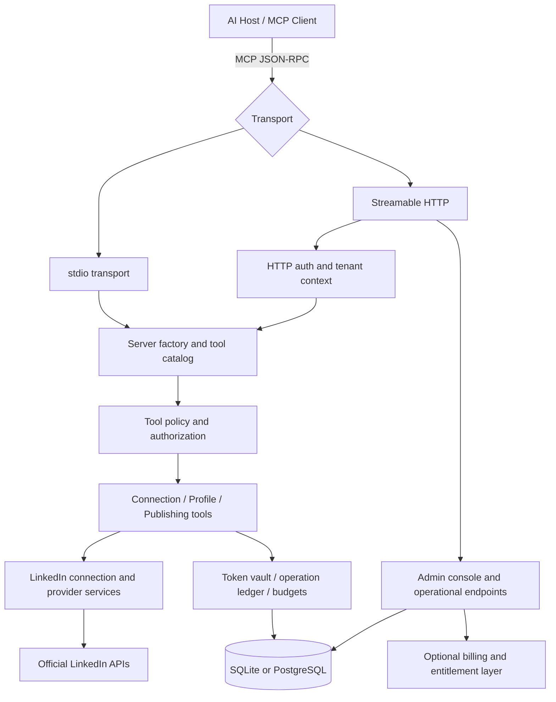
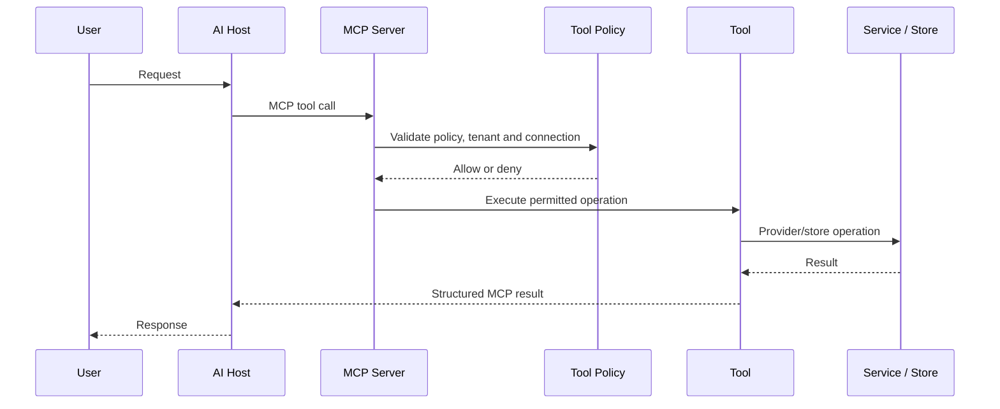
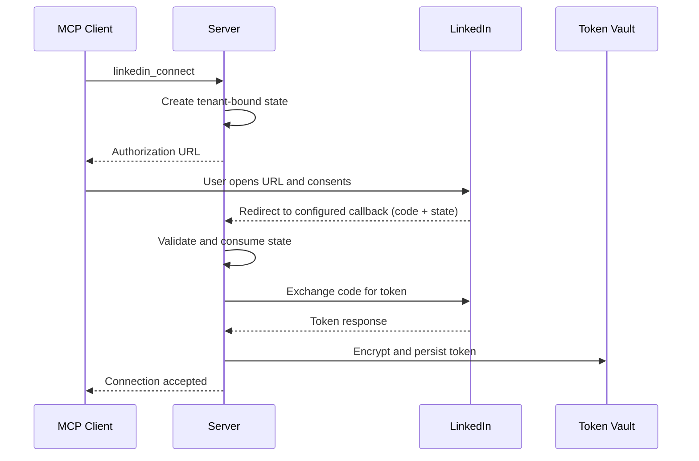
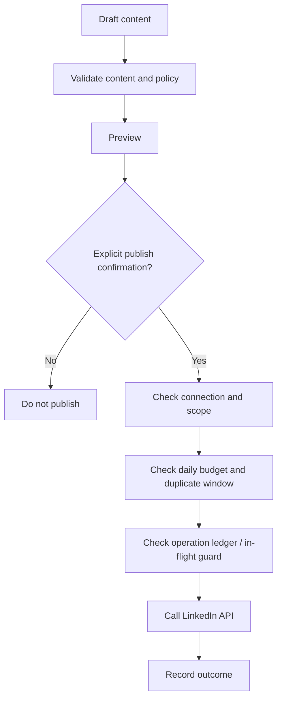
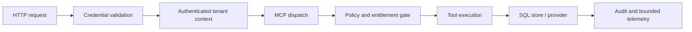

# LinkedIn MCP Server

[](https://github.com/Hugs-4-Bugs/linkedin-mcp-server/actions)
[](LICENSE)
[](https://nodejs.org/)

A security-first, TypeScript Model Context Protocol (MCP) server that connects an AI client to **official LinkedIn API capabilities** for account connection, profile access, and guarded post publishing. It supports local/self-hosted operation and a separately gated hosted billing mode.

> **Access is determined by LinkedIn.** This server does not scrape LinkedIn, use browser cookies, bypass restrictions, or promise access to APIs/scopes/products that LinkedIn has not granted. Product access and API eligibility can change.

## Contents

- [Capabilities](#capabilities)
- [Architecture](#architecture)
- [Data and request flows](#data-and-request-flows)
- [Tools](#tools)
- [Security model](#security-model)
- [Storage and tenancy](#storage-and-tenancy)
- [Billing and self-hosting boundary](#billing-and-self-hosting-boundary)
- [Requirements](#requirements)
- [Quick start](#quick-start)
- [Real LinkedIn OAuth setup](#real-linkedin-oauth-setup)
- [HTTP routes](#http-routes)
- [Configuration](#configuration)
- [Development and verification](#development-and-verification)
- [Project layout](#project-layout)
- [Deployment notes](#deployment-notes)
- [Limitations](#limitations)
- [Documentation and governance](#documentation-and-governance)
- [License](#license)

## Capabilities

| Area | Current implementation |
|---|---|
| MCP transports | stdio and Streamable HTTP |
| LinkedIn OAuth | OAuth 2.0 authorization-code flow (3-legged OAuth) |
| OAuth state | Random, expiring, single-use, tenant-bound state |
| Connection lifecycle | Connect, status, disconnect |
| Profile | Authenticated member OIDC userinfo, strict validation/field allowlist |
| Scope reporting | Requested scopes vs token-response claim, with verification limitations stated |
| Publishing | Draft, preview and guarded publish workflow |
| Write safety | Confirmation schema, content validation, duplicate window, in-flight protection, daily safety budget and operation ledger |
| Local storage | In-memory or SQLite |
| Persistent storage | PostgreSQL |
| Token storage | AES-256-GCM vault; SQL persistence stores encrypted token material |
| Remote auth | SQL-backed session/API-token auth, tenant context, CSRF protections |
| Security | Redacting structured logs, policy authorization, bounded request bodies, rate limits, security headers, retention sweeper, audit events |
| Ops | Liveness/readiness endpoints, Prometheus-style metrics, runbook |
| Hosted billing | Optional Razorpay TEST-mode integration; disabled by default |
| Client targets | MCP-compatible clients; client-specific compatibility must be validated against current client support |

## Architecture

The initial architecture is a modular monolith. Both transports share the server factory and tool catalog; tool logic is not duplicated between transport implementations.



### Component responsibilities

- **Transport layer:** accepts MCP requests over stdio or Streamable HTTP; handles framing, HTTP request boundaries, route dispatch and shutdown.
- **Server factory:** builds shared runtime dependencies and registers MCP tools.
- **Policy layer:** evaluates tool effect, required scopes, connection state and confirmation rules.
- **Tool layer:** validates inputs, invokes services and returns safe structured results.
- **OAuth/provider layer:** constructs LinkedIn authorization URLs, exchanges authorization codes and requests allowed provider data.
- **Token vault:** encrypts token material; tenants are isolated at the storage boundary.
- **Persistence layer:** SQL abstractions and migrations for persistent state.
- **Operational layer:** health/readiness, metrics, audit, logs, console and billing APIs when configured.

## Data and request flows

### MCP tool invocation



### OAuth connection



State is single-use, expires, and is bound to the tenant. OAuth secrets, authorization codes, access tokens and raw provider payloads must not be logged.

### Guarded publishing



Publishing is a real external write. The server intentionally avoids blind retries after ambiguous write outcomes; callers should reconcile the recorded operation state before retrying.

### Persistent request path



Remote mode derives tenant identity from the validated session or API token—not from tool arguments or caller-supplied tenant identifiers.

## Tools

The current catalog includes:

| Tool | Purpose | Safety class |
|---|---|---|
| `linkedin_connect` | Starts OAuth and returns the authorization URL | Rate-limited connection initiation |
| `linkedin_status` | Reports connection state, expiry, captured scopes and member identifier | Read |
| `linkedin_disconnect` | Deletes the tenant's stored LinkedIn token material | Confirmation required |
| `linkedin_get_my_profile` | Retrieves the connected member's validated OIDC userinfo | Read; requires active connection and scopes |
| `linkedin_list_granted_scopes` | Reports requested scopes and captured token-response scope information, including uncertainty | Read |
| `linkedin_draft_post` | Creates/validates a draft for publishing | Non-publishing |
| `linkedin_preview_post` | Previews content and relevant publishing checks | Non-publishing |
| `linkedin_publish_post` | Publishes a post through the authorized LinkedIn API | Explicit confirmation and safety checks |
| `status` | MCP server status | Read |

Tool availability and scope requirements are enforced in code. The server cannot grant additional LinkedIn permissions. Organization/page publishing or other capabilities must not be assumed unless the relevant API access is available and implemented.

## Security model

Security is designed around least privilege, explicit write confirmation and tenant isolation.

- **OAuth state:** cryptographically random, expiring, single-use and tenant-bound.
- **Secrets:** secrets are configuration inputs, not repository artifacts. Logger redaction and secret scanning are part of verification.
- **Token encryption:** AES-256-GCM; persistent token rows contain ciphertext rather than plaintext token values.
- **Tenant identity:** remote requests resolve identity from validated credentials. Caller-provided tenant IDs are not trusted.
- **Authorization policy:** tools declare read/write effect, required scope and confirmation policy.
- **Publishing safety:** explicit confirmation, content checks, duplicate-window checks, daily application safety limits, in-flight protection and an operation ledger.
- **HTTP boundary:** body-size cap, rate limiting, exact route handling, security headers and loopback restriction in local mode.
- **Session security:** password hashing, session/API-token storage by digest, expiry and CSRF controls.
- **Billing:** fail-closed entitlement checks only when hosted billing is enabled; self-hosted billing is off by default.
- **Retention:** scheduled cleanup of expired sessions, API tokens, OAuth state, publish-operation records, budgets and audit data according to configured policy.
- **Logging:** bounded, structured, redacted; sensitive payloads and LinkedIn content are not intended for logs.
- **Audit:** actions and security outcomes are recorded without unnecessary data payloads.

Review [03_SECURITY/SECURITY_POLICY.md](03_SECURITY/SECURITY_POLICY.md) and [03_SECURITY/DATA_PRIVACY.md](03_SECURITY/DATA_PRIVACY.md) for vulnerability reporting and data-retention details. Never submit credentials or live member data in issues, PRs or test fixtures.

## Storage and tenancy

The runtime supports:

- **In-memory:** convenient for local/mock use; state is process-lifetime only.
- **SQLite:** local persistent development/testing mode.
- **PostgreSQL:** persistent deployment mode.

Persistence is behind shared executor/store abstractions and migrations. Persistent mode covers the authentication and connection-related stores, OAuth state, token vault, publishing-operation ledger/budgets and billing/usage stores when enabled.

| Mode | Persistence | Tenant/auth behavior | Typical use |
|---|---|---|---|
| In-memory | Process memory | Local development tenant; local HTTP surface | Quick-start and tests |
| SQLite | Local database file | Local persistence/dev | Local persistent testing |
| PostgreSQL | Database | Remote session/API-token authentication and tenant isolation | Staging/production |

Do not use in-memory mode for a deployment where restart survival, multiple replicas or production identity is required.

## Billing and self-hosting boundary

Billing is an **optional hosted-service feature**, not a requirement for open-source self-hosting.

- Billing is disabled by default.
- Self-hosted deployments with billing disabled do not mount the hosted billing webhook/API surface or require hosted payment.
- Hosted billing currently uses Razorpay TEST-mode integration.
- Billing activation/revocation is driven by verified provider webhook processing; client-side state is not authoritative.
- Entitlement checks and usage metering are enforced server-side in hosted mode.
- Checkout creates a pending state; it does not directly grant entitlement.
- Billing-enabled configuration requires persistent storage and a configured webhook secret; configuration fails closed if those prerequisites are missing.
- Production payment integration must not be described as live/production-ready until provider live-mode credentials, policies, testing and deployment controls are separately reviewed.

See the billing architecture documentation for details.

## Requirements

- Node.js **20 or later** (the project development environment and CI may use a newer version).
- npm.
- Optional database: SQLite for local persistence or PostgreSQL for persistent/remote deployment.
- LinkedIn Developer application credentials for real OAuth integration; mock mode does not require LinkedIn credentials.

## Quick start

Clone and install:

```bash
git clone https://github.com/Hugs-4-Bugs/linkedin-mcp-server.git
cd linkedin-mcp-server
npm install
```

Build and run the default local stdio server (mock provider/in-memory defaults):

```bash
npm run build
npm run start:stdio
```

For development and test workflows, use the scripts below. The server does not need real LinkedIn credentials to run mock-based tests.

## Real LinkedIn OAuth setup

Real OAuth requires a LinkedIn Developer application, the appropriate products/scopes granted by LinkedIn, and a redirect URI that matches **exactly** between the Developer Portal and server configuration.

1. Create or select your LinkedIn Developer application.
2. Enable the product(s) that provide the self-serve OIDC and posting access you are eligible to use. Product approval/availability is controlled by LinkedIn.
3. In the app's **Auth** settings, add the callback URL exactly as configured in the server.
4. Configure these environment values without committing secrets:
   - `OAUTH_PROVIDER=linkedin`
   - `LINKEDIN_CLIENT_ID`
   - `LINKEDIN_CLIENT_SECRET`
   - `LINKEDIN_REDIRECT_URI`
5. For the local HTTP server using the default host/port, the callback route is:

   `http://127.0.0.1:3333/linkedin/callback`

   This URL is only correct when the server is listening on `127.0.0.1:3333` and `LINKEDIN_REDIRECT_URI` is set to the same exact value. Configure the identical value in LinkedIn's authorized redirect URLs.
6. Run the real-provider HTTP server using the configured values:

   ```bash
   ENVIRONMENT=local OAUTH_PROVIDER=linkedin \
   LINKEDIN_CLIENT_ID="..." LINKEDIN_CLIENT_SECRET="..." \
   LINKEDIN_REDIRECT_URI="http://127.0.0.1:3333/linkedin/callback" \
   npm run start:http
   ```

7. Start the connection flow with the `linkedin_connect` tool, open the returned authorization URL in a browser, and complete consent.
8. Check `linkedin_status`, `linkedin_get_my_profile` and `linkedin_list_granted_scopes` as appropriate.

The callback route is implemented at `GET /linkedin/callback`. A local HTTP MCP endpoint is not a public hosted endpoint; local OAuth testing must be performed from the machine where the callback server is reachable. Do not expose the local server to the public internet.

### OAuth scope and access caveats

The server requests its configured self-serve scope set (currently `openid`, `profile`, `email`, `w_member_social`). Actual granted access is determined by LinkedIn and the token response. Scope reporting is transparent about what cannot be independently introspected. Do not infer access to messaging, invitations, analytics, organization data, search or other restricted APIs.

## HTTP routes

The HTTP transport is not the same thing as the MCP tool endpoint. Relevant routes include:

| Route | Purpose | Notes |
|---|---|---|
| `/mcp` | MCP Streamable HTTP endpoint | Local loopback; remote requires authentication according to environment |
| `/linkedin/connect` | Starts the browser OAuth flow | GET; remote requires authenticated session |
| `/linkedin/callback` | OAuth callback handler | GET; configured redirect URI must match |
| `/mock/linkedin/authorize` | Mock provider consent simulation | Only when mock provider is active |
| `/admin` | Self-contained operator console | Authentication/session boundary applies remotely |
| `/auth/login`, `/auth/logout`, `/auth/state` | Remote auth lifecycle | Session and CSRF controls |
| `/healthz` | Liveness | Lightweight |
| `/ready` | Readiness | Persistent mode probes the database |
| `/metrics` | Prometheus text metrics | Bounded labels; avoids tenant identifiers |
| `/webhooks/razorpay` | Hosted billing webhook | Only mounted when billing is enabled/configured |
| `/api/billing/summary`, `/api/billing/checkout`, `/api/billing/cancel` | Billing console API | Authenticated/CSRF-protected; billing-disabled mode returns unavailable |

Remote HTTP deployment requires TLS termination at a trusted proxy and appropriate external configuration. Do not expose a local, unauthenticated development configuration to an untrusted network.

## Configuration

Environment variables are parsed centrally and validated at startup. The exact schema and defaults are authoritative in `src/config/config.ts`; this table is a guide.

| Variable | Purpose |
|---|---|
| `ENVIRONMENT` | `local`, `staging` or `production` |
| `SERVER_NAME` / `SERVER_VERSION` | MCP server identity |
| `HTTP_HOST` / `HTTP_PORT` | HTTP binding; local mode is restricted to loopback |
| `OAUTH_PROVIDER` | `mock` or `linkedin` |
| `LINKEDIN_CLIENT_ID` | LinkedIn application ID |
| `LINKEDIN_CLIENT_SECRET` | LinkedIn application secret |
| `LINKEDIN_REDIRECT_URI` | Exact OAuth redirect URL |
| `TOKEN_VAULT_KEY` | Base64-encoded 32-byte vault master key; required in production |
| `OAUTH_STATE_TTL_SECONDS` | OAuth state TTL |
| `PUBLISH_DAILY_LIMIT` | Application-level daily publish safety limit |
| `PUBLISH_DUPLICATE_WINDOW_MINUTES` | Duplicate content safety window |
| `DATABASE_URL` | Persistent storage connection/configuration |
| `AUTH_MODE` | Session or local-only mock auth mode |
| `SESSION_TTL_SECONDS` | Session lifetime |
| `RETENTION_SWEEP_INTERVAL_SECONDS` | Retention sweeper interval |
| `AUDIT_RETENTION_DAYS` | Audit retention horizon |
| `MAX_BODY_MIB` | HTTP request-body cap |
| `HTTP_RATE_LIMIT_PER_MINUTE` | HTTP request rate limit |
| `SESSION_COOKIE_NAME` | Session cookie name |
| `BILLING_ENABLED` | Explicitly enables optional hosted billing |
| `RAZORPAY_WEBHOOK_SECRET` | Billing webhook verification secret |
| `BILLING_PLAN_LIMITS` | JSON mapping of plan IDs to usage allowances |
| `BILLING_CACHE_TTL_SECONDS` | Entitlement cache TTL |

Production config rejects mock providers/auth, requires persistent storage and a vault key. Billing activation additionally requires persistent storage and the webhook secret. See the source schema for validation rules and current defaults. Never commit a populated `.env`.

## Development and verification

Useful commands:

```bash
npm install
npm run typecheck
npm run lint
npm run build
npm test
npm run audit
npm run scan:secrets
npm run verify
```

The `verify` script runs typecheck, lint, build, tests and dependency audit. Secret scanning is a separate explicit gate. Workspace smoke scripts exercise compiled stdio/HTTP server flows:

```bash
node scripts/workspace-stdio-smoke.mjs
node scripts/workspace-http-smoke.mjs
```

The test suite includes unit, security/regression, SQLite, and PostgreSQL integration coverage. Environment-dependent tests may require provisioning or can be skipped; record any skips in review/CI context rather than treating them as passed.

### Pull request quality gates

Before submitting a PR:

1. Link the issue using `Refs #N` (the repository owner closes issues; avoid auto-closing issue references).
2. Run typecheck, lint, build, tests, dependency audit and secret scan.
3. Include regression tests for security-relevant changes, including rejected paths.
4. Update documentation for user-visible behavior or configuration changes.
5. Never use real LinkedIn credentials, tokens, private member data or secrets in tests, logs, screenshots or PRs.
6. Commit with DCO sign-off (`git commit -s`) as required by [CONTRIBUTING.md](CONTRIBUTING.md).

## Project layout

The tree evolves; this is a representative map of the current modules:

```text
src/
  auth/
    linkedin/       # OAuth provider, state store, connection service, vault
    users/          # Remote authentication/session/API-token stores
  billing/          # Optional hosted entitlement, subscription and webhook logic
  config/            # Central validated configuration
  identity/          # Tenant context and request context propagation
  mcp/
    transport/       # stdio/HTTP entry points and HTTP admin/billing routes
    serverFactory.ts # Runtime assembly and tool registration
  observability/     # Structured redacting logger and metrics
  policy/            # Tool authorization and policy definitions
  storage/           # SQL executors, migrations and retention
  tools/             # MCP tools and their schemas
  usage/              # Rate-limit and quota helpers
scripts/              # preflight, secret scan and smoke scripts
tests/                # Unit, integration, security and client-compat tests
```

The source tree and tests are the definitive description of implementation. This README intentionally avoids claiming unimplemented or restricted LinkedIn capabilities.

## Deployment notes

- **Local:** loopback HTTP or stdio; mock OAuth and in-memory mode are suitable for development only.
- **Persistent local:** SQLite can be used for persistence/testing.
- **Remote/staging:** use PostgreSQL, persistent vault key, real authentication and OAuth provider, HTTPS via a trusted TLS proxy, secure environment/secret management and operational probes.
- **Production:** production startup validation rejects mock auth/provider, requires persistence and vault key. Use least privilege, backups, monitoring, tested recovery and reviewed retention configuration.
- **Billing-enabled hosted service:** requires the explicit billing configuration and webhook secret; use test mode until a separately documented live-mode review and verification are complete.

## Limitations

- LinkedIn controls products, access tiers, scopes, rate limits, app approval and API availability.
- OAuth consent and token validity are not a guarantee of access to every LinkedIn API.
- The self-serve implementation must not be represented as a LinkedIn partner integration.
- Organization/page publishing and restricted endpoints are not promised unless the relevant official access and code are available.
- Local HTTP mode is for development and is not an internet-facing deployment.
- Hosted billing integration currently described in the changelog is TEST-mode; do not treat it as a production payment launch.
- Client compatibility is version-dependent; test each client and document its limitations.
- This software is provided without warranty under its license.

## Documentation and governance

- [CONTRIBUTING.md](CONTRIBUTING.md) — development, test gates and DCO sign-off.
- [CODE_OF_CONDUCT.md](CODE_OF_CONDUCT.md) — community conduct.
- [03_SECURITY/SECURITY_POLICY.md](03_SECURITY/SECURITY_POLICY.md) — vulnerability reporting and security scope.
- [NOTICE](NOTICE) — attribution/notices.
- [LICENSE](LICENSE) — AGPL-3.0-or-later.
- [CHANGELOG.md](CHANGELOG.md) — release history.
- [RELEASE_CHECKLIST.md](RELEASE_CHECKLIST.md) — release controls, where present.
- [03_SECURITY/DATA_PRIVACY.md](03_SECURITY/DATA_PRIVACY.md) — retention and data handling.

Contribution policy and code of conduct are maintained in their own documents; this README summarizes the project rather than duplicating every governance requirement.

## License

This project is licensed under the **GNU Affero General Public License v3.0 or later (AGPL-3.0-or-later)**. See [LICENSE](LICENSE) for the complete terms and [NOTICE](NOTICE) for additional notices.

Network users of a modified AGPL-covered version are entitled to the Corresponding Source under the license's terms. Hosted commercial operation, trademark rights and any separate commercial agreements are distinct from the open-source license; see the repository's applicable legal and branding documents.

---

**LinkedIn MCP Server** — use official API access, enforce safe tool boundaries, and be explicit about what the platform actually permits.
